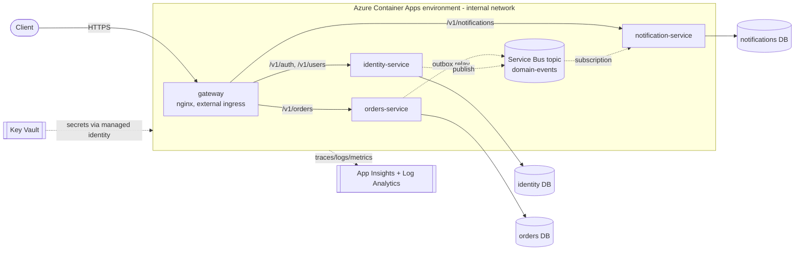

# Architecture & design decisions

## System view

| Service | Owns | Sync API | Publishes | Consumes |
|---|---|---|---|---|
| identity-service | `users` | register, token, me | `identity.user.registered` | - |
| orders-service | `orders`, `order_items`, `outbox` | create, list, get, cancel | `orders.order.created`, `orders.order.cancelled` | - |
| notification-service | `notifications` | list, mark read | - | all three above |

## Key decisions (and the trade-offs to talk about)

### 1. Database per service
Each service has its own database and never reads another's tables. This
keeps services independently deployable and lets schemas evolve freely. The
cost: no cross-service joins and no distributed transactions, which is why
the event-driven pieces below exist.

### 2. Async communication with events, not service-to-service HTTP
Orders do not call notifications. They emit a fact (`order.created`) and
whoever cares subscribes. Adding a new consumer (billing, analytics) needs
no change to orders-service, and a notification outage never breaks checkout.

### 3. Transactional outbox (orders-service)
Writing to the DB and then publishing to the bus is a *dual write*: if the
process dies in between, you have an order without an event. Instead the
event is inserted into an `outbox` table **in the same transaction** as the
order. A background relay publishes pending rows; `FOR UPDATE SKIP LOCKED`
lets every replica relay safely in parallel.

identity-service deliberately publishes directly (best effort) to show the
contrast: a lost welcome message is acceptable; a lost order event is not.

### 4. At-least-once delivery + idempotent consumers
The outbox can re-send (crash after publish, before marking sent). Two
safety nets:
* Service Bus **duplicate detection** keyed on `message_id = event.id`.
* notification-service has a **unique constraint on `event_id`**, so a
  redelivered event is a no-op.

Failures are retried (Service Bus abandon -> redelivery) and land in the
**dead-letter queue** after `maxDeliveryCount = 10`.

### 5. Idempotent writes over HTTP
`POST /v1/orders` accepts an `Idempotency-Key`. A retry after a timeout
returns the original order (`200`) instead of creating a duplicate. A unique
constraint `(customer_id, idempotency_key)` makes this safe under races too.

### 6. Stateless JWT auth verified locally
identity-service issues short-lived JWTs (`iss`, `aud`, `exp`, `jti`); every
other service verifies them in-process, with no network hop per request.
**Next step for production:** switch to asymmetric keys (RS256 + JWKS
endpoint) or Microsoft Entra ID / Entra External ID, so only the issuer
holds a signing key. The verification code is isolated in
`orderflow_common.security` so that swap touches one module.

### 7. Zero secrets in code, images or pipelines
* Apps authenticate to ACR, Key Vault and Service Bus with **per-service
  user-assigned managed identities** (least privilege: only orders and
  identity may *send*, only notifications may *receive*).
* Service Bus has `disableLocalAuth: true`, so SAS keys can't be used at all.
* `DATABASE_URL` / `JWT_SECRET` are Key Vault secrets referenced by Container
  Apps. CI uses GitHub OIDC federation, so no Azure credentials are stored in GitHub.

### 8. Observability built in
* JSON logs with `correlation_id`, `service`, `env`, `user_id`.
* `X-Correlation-ID` is accepted or minted at the gateway, propagated to
  services, put on every event, and restored in consumers. One ID follows a
  request across HTTP **and** async hops.
* Azure Monitor OpenTelemetry distro gives distributed traces, dependency
  maps and live metrics when `APPLICATIONINSIGHTS_CONNECTION_STRING` is set.
* `/health/live` (liveness) vs `/health/ready` (DB + bus reachable) map
  to Container Apps probes, so a replica that loses its DB stops getting traffic
  instead of being restarted in a loop.

### 9. Consistent platform library
`libs/common` (`orderflow_common`) gives every service the same middleware,
error format (RFC 7807), config validation, health probes and graceful
shutdown. Services contain only business logic. Trade-off: a shared lib
couples release cadence. Keep it small, versioned and free of business logic.

### 10. Safe schema migrations
Alembic migrations run on container start behind a Postgres **advisory
lock**, so N replicas starting together don't race. For large or
destructive migrations, run them as a separate Container Apps Job and use
expand/contract (add column -> backfill -> switch -> drop) for zero downtime.

## Scaling & resilience

| Concern | How |
|---|---|
| HTTP load | Container Apps KEDA http rule (50 concurrent req/replica), 1-3 replicas in dev, 2-10 in prod |
| Message backlog | Scale notification-service on subscription length (KEDA `azure-servicebus` scaler) |
| Zone failure (prod) | PostgreSQL zone-redundant HA, min 2 replicas per app |
| Abuse | Gateway per-IP rate limits (stricter on `/v1/auth/*`), 1 MB body cap |
| Slow dependencies | Readiness checks with timeouts, connect/read timeouts at the gateway, `pool_pre_ping` + `pool_recycle` on DB pools |
| Poison messages | Dead-letter queue (Service Bus) / `domain-events.dlq` stream (local) |

## Hardening roadmap (deliberately out of scope for the demo)

1. **Network isolation**: VNet-integrated Container Apps environment, private
   endpoints for PostgreSQL, Key Vault, Service Bus and ACR; disable public access.
2. **Edge**: Azure Front Door + WAF, or API Management for API products,
   quotas, developer portal and JWT validation at the edge.
3. **Identity**: Entra ID for user auth; Entra auth to PostgreSQL (no password).
4. **Delivery**: blue/green with Container Apps revisions + traffic splitting;
   contract tests on event schemas; load tests (Azure Load Testing) in the pipeline.
5. **Ops**: Alert rules (5xx rate, p95 latency, DLQ depth > 0), dashboards,
   SLOs with error budgets.
