# OrderFlow process diagrams

Eleven diagrams covering the whole system: how a request travels, how events stay reliable,
what happens inside each service, and how code reaches Azure. Every number on them
(intervals, retry counts, status codes) comes from the code in this folder.
GitHub renders the Mermaid blocks below as diagrams.

- **Runtime:** [System architecture](#architecture) · [Placing an order, end to end](#place-order) · [Sign-up, login and token checks](#auth)
- **Reliability:** [Idempotency-Key: no double orders](#idempotency) · [Outbox relay loop](#outbox) · [Handling an incoming event](#consumer)
- **Inside a service:** [A request inside one service](#pipeline) · [Container start, health and shutdown](#lifecycle)
- **Delivery:** [CI: what runs on every change](#ci) · [CD: dev, then prod](#cd) · [Azure resources and permissions](#azure)

## Runtime

### System architecture

Who talks to whom. Only the gateway is reachable from outside; every service owns its own database and services never call each other.

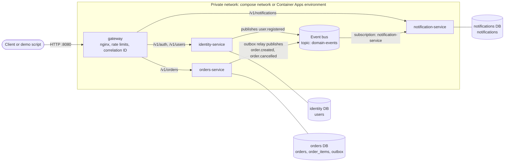

Synchronous HTTP goes through the gateway. Everything between services travels as events on the bus. Locally the bus is Redis Streams; on Azure it is a Service Bus topic.

> **In the interview:** Database per service keeps teams independent. The price is no cross-service joins, which is why the services share facts through events instead.

### Placing an order, end to end

The full journey the demo script exercises: the HTTP request returns as soon as the order is saved, and the notification follows asynchronously.

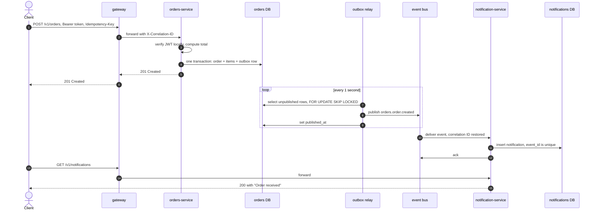

Step 4 is the key: the order and its event are written in one transaction. The client already has its 201 before the event leaves the service.

> **In the interview:** orders-service never calls notification-service. If notifications are down, checkout still works and the notification arrives when it recovers.

### Sign-up, login and token checks

identity-service is the only service that knows passwords. It signs a short-lived JWT, and every other service checks that token on its own.

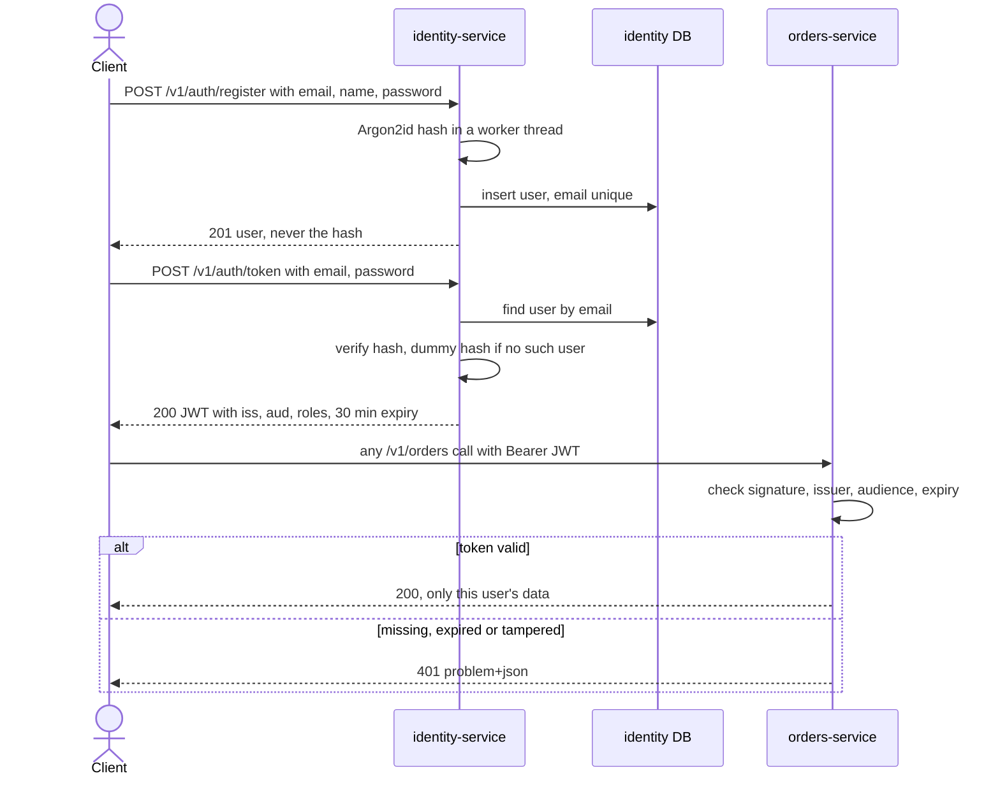

Verification is local: no service calls identity-service per request. Unknown emails are checked against a dummy hash so response time does not reveal who has an account.

> **In the interview:** Next step for real production: asymmetric keys (RS256 + JWKS) or Microsoft Entra ID, so only the issuer can sign tokens. The check lives in one module, so that swap is small.

## Reliability

### Idempotency-Key: no double orders

What orders-service does with each POST. A client that times out and retries gets the original order back instead of a second one.

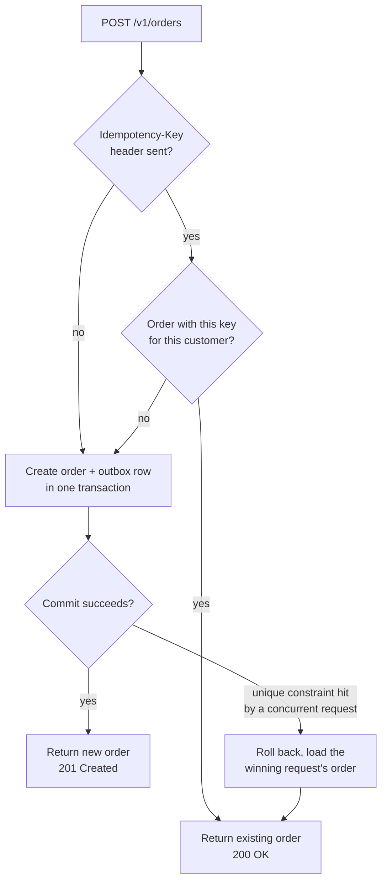

The unique constraint on customer and key settles the race when two identical requests arrive at the same moment: the loser rolls back and returns the winner's order.

> **In the interview:** In the demo, the retried request returns 200 with the same order id. That is this diagram's left branch.

### Outbox relay loop

The background task inside orders-service that moves saved events to the bus. It is why an order and its event can never get out of step.

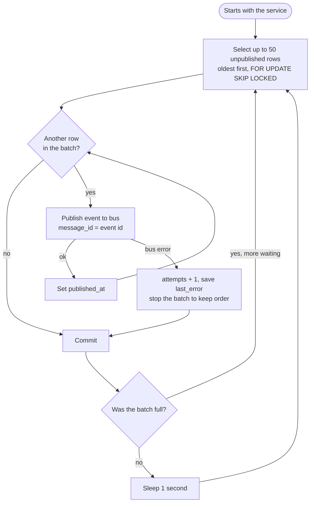

SKIP LOCKED lets every replica run this loop without sending the same row twice. On a bus error the row stays unpublished and is retried on the next tick, in order.

> **In the interview:** This solves the dual-write problem: saving to the database and publishing to a broker can't be made atomic, so the event is saved with the order and sent afterwards.

### Handling an incoming event

What notification-service does with each delivered event. Delivery is at-least-once, so the same event can arrive twice and must be harmless.

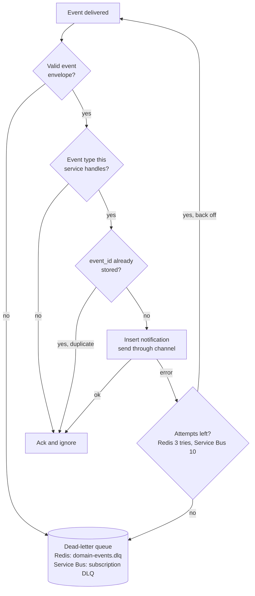

Dedupe happens on the stored event_id. Failures are retried, then parked in a dead-letter queue for an operator instead of blocking everything behind them.

> **In the interview:** Two safety nets against duplicates: Service Bus duplicate detection on message_id, and a unique event_id column in the consumer's own table.

## Inside a service

### A request inside one service

Every service is built by the same app factory, so this path is identical in all three. Only the service layer is business code.

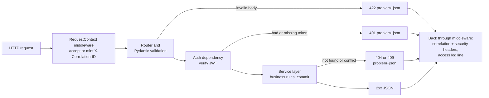

Whatever happens, the response leaves through the middleware, which adds the correlation ID and security headers and writes one access-log line.

> **In the interview:** Consistency across services is what makes a fleet operable: same error shape, same logs, same probes, without each team rebuilding them.

### Container start, health and shutdown

What happens from container start to shutdown, and how the platform's probes decide whether to restart a container or just stop sending it traffic.

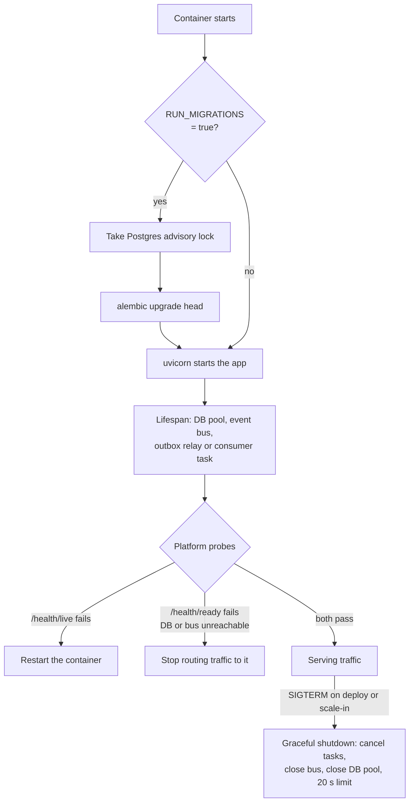

The advisory lock means several replicas can start at once and only one runs migrations. Readiness covers dependencies; liveness only covers the process itself.

> **In the interview:** Separating liveness from readiness avoids restart loops: losing the database takes a replica out of rotation instead of killing it repeatedly.

## Delivery

### CI: what runs on every change

The checks GitHub Actions runs for any push or pull request that touches the project folder.

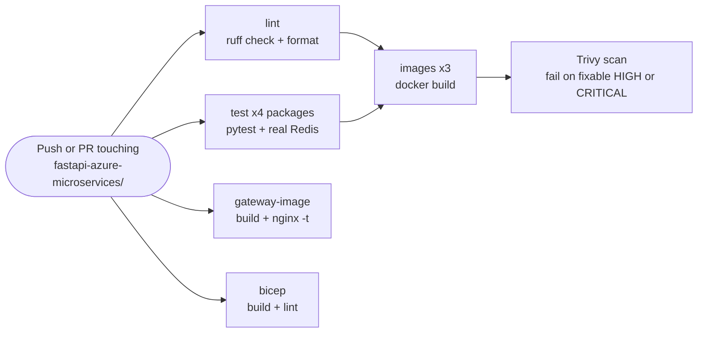

Image builds wait for lint and tests. Each image is scanned with Trivy and the job fails on any HIGH or CRITICAL vulnerability that already has a fix.

> **In the interview:** Tests include a real Redis, because the two event-bus bugs found while testing this project only showed up against the real thing.

### CD: dev, then prod

The manually triggered deployment. Dev builds the images; prod reuses exactly those images after a reviewer approves.

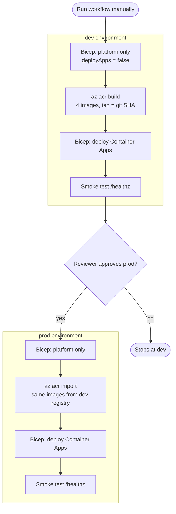

Each environment first deploys the platform without apps, so the registry exists before any image is pushed. Authentication uses GitHub OIDC, so no Azure credentials are stored in GitHub.

> **In the interview:** Build once, deploy many: prod runs the exact image that passed in dev, not a rebuild that could differ.

### Azure resources and permissions

What Bicep creates, and exactly what each app is allowed to touch. Every app has its own managed identity, so there are no passwords or keys in configuration.

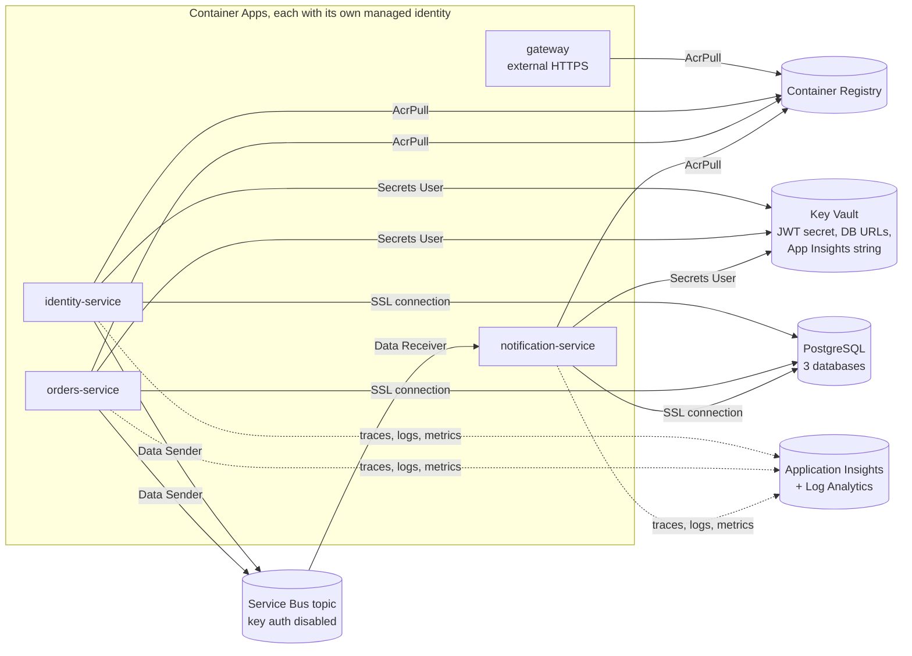

Only identity and orders may send events; only notifications may receive them. Service Bus has key-based auth switched off, so the managed identities are the only way in.

> **In the interview:** Least privilege per service: a compromised notification-service can't publish fake order events, because it simply has no send permission.

---

Design decisions behind these flows: [architecture.md](architecture.md). Demo script: [interview-walkthrough.md](interview-walkthrough.md).
